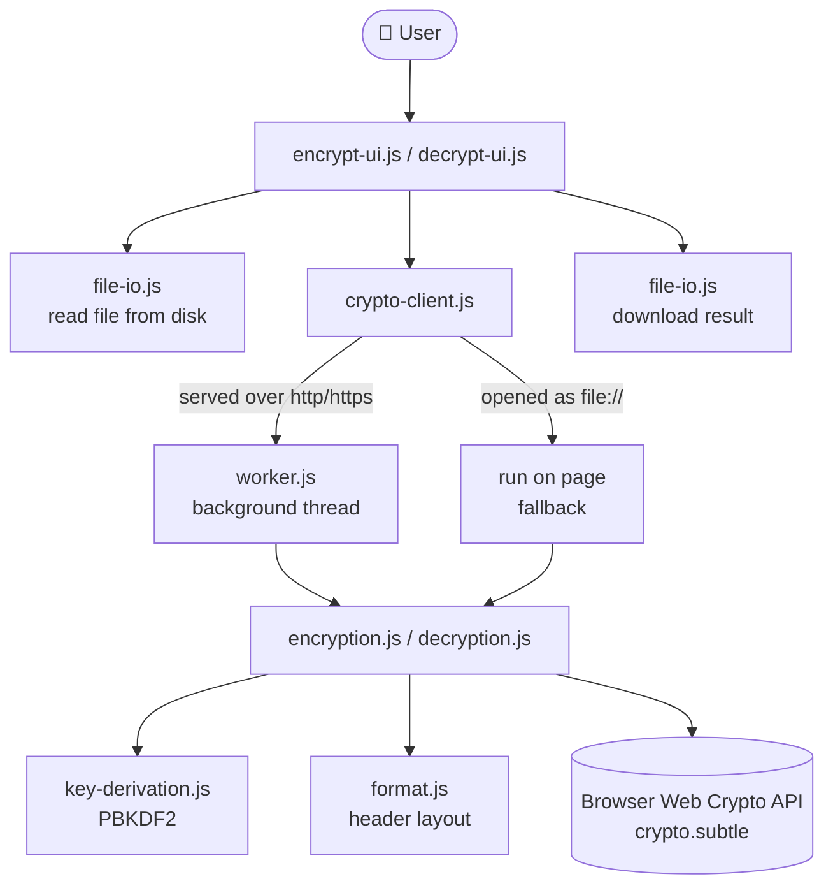
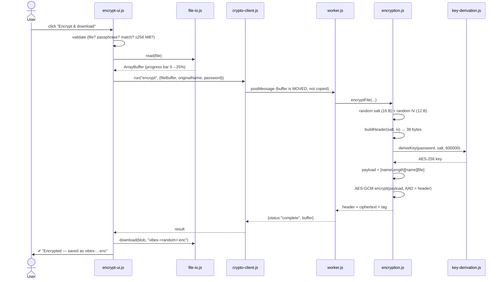
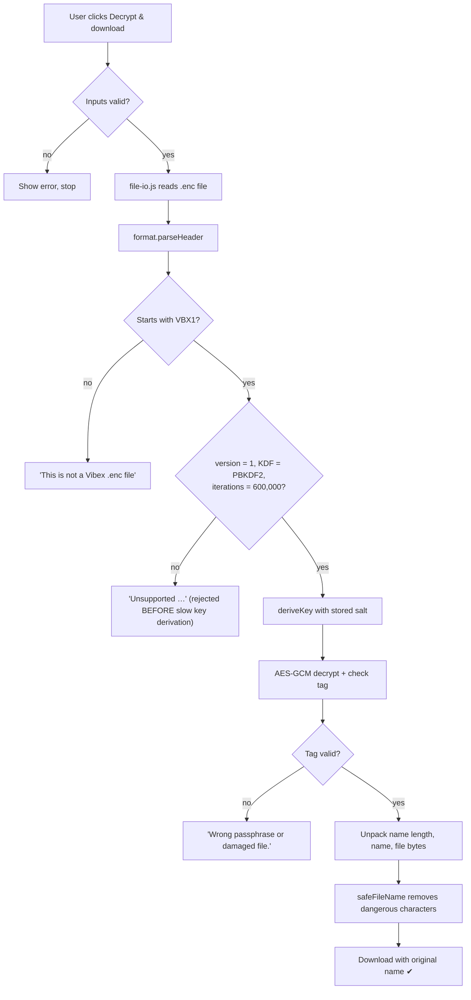
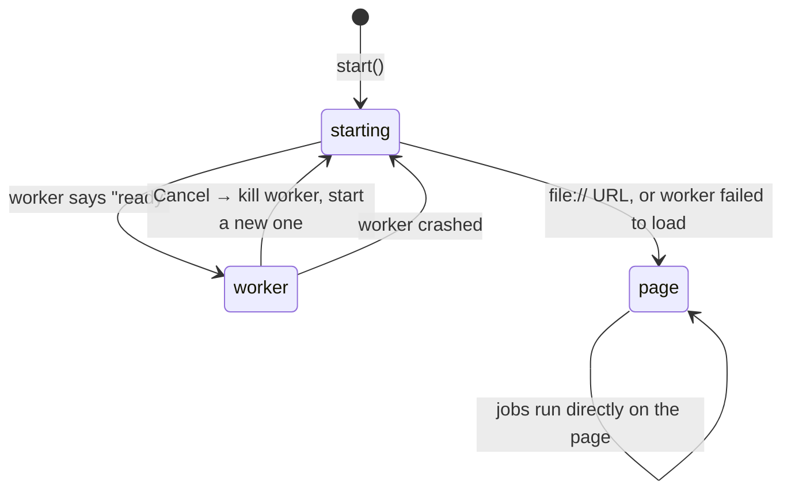

# Vibex — Project Documentation

> **Vibex** is a website that encrypts and decrypts files **inside your browser**.
> Your file and your passphrase never leave your computer. There is no server and no upload.

This document explains **how the code works, step by step**, for any reader:
students, teachers, reviewers, or future-you.

> **Tip:** The diagrams marked `mermaid` render as real flowcharts on **GitHub** and in
> **VS Code** (with the *Markdown Preview Mermaid Support* extension). Every important
> diagram also has a plain-text version, so this file works in any viewer.

---

## Table of contents

1. [Quick start](#1-quick-start)
2. [Project structure](#2-project-structure)
3. [The big picture](#3-the-big-picture)
4. [How the page starts up](#4-how-the-page-starts-up)
5. [Cryptography in plain English](#5-cryptography-in-plain-english)
6. [Encryption, step by step](#6-encryption-step-by-step)
7. [Decryption, step by step](#7-decryption-step-by-step)
8. [The `.enc` file format (byte by byte)](#8-the-enc-file-format-byte-by-byte)
9. [The Web Worker and crypto-client](#9-the-web-worker-and-crypto-client)
10. [Password generator and strength meter](#10-password-generator-and-strength-meter)
11. [User interface modules](#11-user-interface-modules)
12. [Security design decisions](#12-security-design-decisions)
13. [Threat model and limitations](#13-threat-model-and-limitations)
14. [The self-test](#14-the-self-test)
15. [How to customise](#15-how-to-customise)
16. [Troubleshooting](#16-troubleshooting)
17. [Glossary](#17-glossary)

---

## 1. Quick start

### Option A: just open it
Double-click `index.html`. Everything works. (The crypto runs on the main page instead of a
background thread, because browsers block Web Workers on `file://` pages. See [section 9](#9-the-web-worker-and-crypto-client).)

### Option B: run a local server (recommended, enables the Web Worker)
```bash
# from the project folder
python -m http.server 8000
# then open http://localhost:8000
```

### Option C: host it online
Upload the whole folder (`index.html`, `css/`, `js/`) to any static host that uses **HTTPS**
(GitHub Pages, Netlify, Cloudflare Pages…).

> ⚠ The browser's crypto API (`crypto.subtle`) only exists on **HTTPS**, **localhost**, or a
> **local file**. On plain `http://` a red banner says *"Encryption requires HTTPS or localhost."*

### Using it
| Encrypt | Decrypt |
|---|---|
| 1. Click **Encrypt a file** | 1. Click **Decrypt a file** |
| 2. Choose or drop a file | 2. Choose or drop the `.enc` file |
| 3. Type a passphrase twice, or press the 🎲 dice | 3. Type the same passphrase |
| 4. Click **Encrypt & download** → `vibex-xxxxxxxx.enc` | 4. Click **Decrypt & download** → original file with its original name |

---

## 2. Project structure

The project follows **separation of concerns**: HTML = structure, CSS = looks, JS = behaviour.
Each JS file has **one job**.

```
Encrypt yor data/
│
├── index.html                    STRUCTURE — only HTML, links every file below
├── DOCUMENTATION.md              this file
├── _backup/index.original.html   the original single-file version
│
├── css/                          ── STYLE ──────────────────────────────────
│   ├── variables.css             every color (dark + light theme), fonts, sizes
│   ├── base.css                  reset, body background, focus outline, animations
│   ├── background-dots.css       dot color, line opacity, line distance
│   ├── nav.css                   top bar, link underline animation, theme toggle
│   ├── hero.css                  big title, Encrypt/Decrypt buttons, footer
│   ├── modal.css                 popups, Encrypt|Decrypt tab switch, self-test box
│   ├── form.css                  drop zone, inputs, strength bars, progress, messages
│   └── responsive.css            phone layout (loaded LAST so it wins)
│
└── js/                           ── LOGIC ──────────────────────────────────
    ├── theme-init.js             chooses dark/light BEFORE the page is drawn
    ├── utils.js                  small shared helpers (messages, sizes, safe names)
    ├── app-state.js              "is a job running?" flag + Cancel
    │
    ├── crypto/                   ── pure cryptography, no buttons/HTML ──
    │   ├── format.js             .enc file layout + all crypto constants
    │   ├── key-derivation.js     passphrase  →  AES key   (PBKDF2)
    │   ├── encryption.js         ENCRYPT a file           (AES-256-GCM)
    │   ├── decryption.js         DECRYPT a file
    │   ├── self-test.js          "Run crypto self-test" checks
    │   └── worker.js             background thread that runs the files above
    │
    ├── crypto-client.js          page ⇄ worker messenger (with fallback)
    ├── file-io.js                read the chosen file, download the result
    ├── password-generator.js     🎲 dice button
    ├── password-strength.js      4-bar strength meter
    ├── drop-zone.js              "Choose a file / drop it here" boxes
    ├── modal.js                  open/close popups, keyboard support
    ├── theme.js                  ☀/☾ toggle button
    ├── info-pages.js             text of User Guide / Security / Privacy
    ├── encrypt-ui.js             what happens on the Encrypt tab
    ├── decrypt-ui.js             what happens on the Decrypt tab
    ├── background-dots.js        the floating dots animation
    └── main.js                   starts everything, connects buttons (LAST)
```

---

## 3. The big picture

The code is split into **three layers**. Each layer only talks to the one below it.

```
┌──────────────────────────────────────────────────────────────────────┐
│  LAYER 1 — USER INTERFACE  (what you see and click)                  │
│  main.js · encrypt-ui.js · decrypt-ui.js · drop-zone.js · modal.js   │
│  theme.js · info-pages.js · password-generator.js · password-strength│
└───────────────────────────────┬──────────────────────────────────────┘
                                │  Vibex.cryptoClient.run("encrypt", …)
                                ▼
┌──────────────────────────────────────────────────────────────────────┐
│  LAYER 2 — MESSENGER  (decides WHERE the crypto runs)                │
│  crypto-client.js  +  file-io.js                                     │
└───────────────────────────────┬──────────────────────────────────────┘
                                │  postMessage(…)   or direct call
                                ▼
┌──────────────────────────────────────────────────────────────────────┐
│  LAYER 3 — CRYPTOGRAPHY  (pure math, no HTML, no buttons)            │
│  worker.js → format.js · key-derivation.js · encryption.js ·         │
│              decryption.js · self-test.js                            │
│                       uses the browser's built-in Web Crypto API     │
└──────────────────────────────────────────────────────────────────────┘
```

**Why layers?** The crypto files have **no idea a web page exists**. That means they can be
tested alone, reused in a worker, and reviewed by a security person without reading UI code.



---

## 4. How the page starts up

### 4.1 Loading order

Order matters, because a file can only use code that has already loaded.

```
<head>
  1. js/theme-init.js      ← runs immediately: sets dark/light so there's no "flash"
  2. css/*.css             ← all styles
<body>
  3. the HTML (nav, hero, modals, canvas)
  4. js/utils.js           ← helpers every other file needs
  5. js/app-state.js
  6. js/crypto/*.js        ← cryptography
  7. js/crypto-client.js
  8. js/file-io.js … js/background-dots.js   ← features
  9. js/main.js            ← LAST: connects buttons and starts everything
```

Scripts sit at the **end** of `<body>` so the HTML elements already exist when they run.

### 4.2 How the files share code: the `Vibex` object

There are no imports or build tools. Every JS file uses the same pattern:

```js
(function (Vibex) {          // 1. a private "room" for this file's code
  "use strict";

  function secretHelper() {} // 2. PRIVATE: other files can't see this

  function generate() {}     //    the useful function

  Vibex.passwordGenerator = { generate: generate };   // 3. PUBLIC: shared on Vibex
})(window.Vibex = window.Vibex || {});                // 4. create Vibex if it doesn't exist yet
```

After all scripts have loaded, the global object looks like this:

```
window.Vibex
├── utils              $, formatBytes, safeFileName, showMessage, progressBar …
├── app                busy, cryptoReady, setBusy(), cancel()
├── format             MAGIC, ITERATIONS, buildHeader(), parseHeader() …
├── keyDerivation      deriveKey()
├── encryption         encryptFile()
├── decryption         decryptFile()
├── selfTest           run()
├── cryptoClient       start(), run(), cancel(), shutdown()
├── fileIO             read(), abort(), download(), randomEncryptedName()
├── theme              toggle()
├── passwordGenerator  generate()
├── passwordStrength   evaluate(), label()
├── dropZone           setup()
├── modal              open(), close(), isOpen()
├── infoPages          open()
├── encryptUI          init(), reset()
└── decryptUI          init(), reset()
```

> **Note:** `js/crypto/*.js` files use `self.Vibex` instead of `window.Vibex`. `self` works
> in **both** a web page and a Web Worker (a worker has no `window`), so the same file can be
> loaded in both places.

### 4.3 What `main.js` does

```
main.js
 ├─ Vibex.cryptoClient.start()   → start loading the background worker
 ├─ Vibex.encryptUI.init()       → wire up the Encrypt tab
 ├─ Vibex.decryptUI.init()       → wire up the Decrypt tab
 ├─ connect nav buttons          → infoPages.open("guide" | "security" | "privacy")
 ├─ connect theme toggle         → theme.toggle()
 ├─ connect hero buttons         → openVault("encrypt" | "decrypt")
 ├─ pagehide                     → stop the worker, free memory
 ├─ beforeunload                 → "Leave site?" if a job is running
 └─ if no HTTPS                  → show the red warning banner
```

---

## 5. Cryptography in plain English

Read this before sections 6 and 7.

### 5.1 The problem
You want to lock a file with a **passphrase** a human can remember, such that:
- nobody without the passphrase can read it (**confidentiality**)
- nobody can secretly change it (**integrity**)
- guessing the passphrase is extremely slow (**brute-force resistance**)

### 5.2 The tools

| Tool | What it is | Analogy | Where |
|---|---|---|---|
| **AES-256** | The cipher: scrambles data with a 256-bit key | The lock | `encryption.js` |
| **GCM mode** | Lets AES handle any length **and** adds a tamper-proof seal (the *tag*) | A wax seal on the envelope | `encryption.js` |
| **PBKDF2** | Turns a passphrase into a 256-bit key, slowly on purpose | A key-cutting machine that takes 0.5 s per key | `key-derivation.js` |
| **Salt** | 16 random bytes, new for every file, mixed into PBKDF2 | Makes every file's lock unique | `format.js` |
| **IV / nonce** | 12 random bytes, new for every file, given to AES-GCM | Starting position of the scrambler | `format.js` |
| **AAD** | Data that is **not hidden** but **is sealed** (our header) | Writing on the outside of the envelope, under the seal | `encryption.js` |
| **CSPRNG** | `crypto.getRandomValues()`, unpredictable random numbers | Fair dice | everywhere |

### 5.3 How they fit together

```
   passphrase ───┐
                 ├──► PBKDF2-SHA256 (600,000 rounds) ──► 256-bit AES KEY
   random salt ──┘                                          │
                                                            ▼
   random IV ─────────────────────────────────────►  AES-256-GCM  ──► ciphertext + 16-byte TAG
   header (AAD) ──────────────────────────────────►  (encrypt)
   filename + file bytes (plaintext) ─────────────►
```

### 5.4 Why each part matters

- **Why 600,000 iterations?** One wrong guess costs an attacker 600,000 HMAC calculations.
  You only pay that cost once (about half a second). 600k is OWASP's recommendation for
  PBKDF2-HMAC-SHA256.
- **Why a salt?** Without it, the same passphrase would always give the same key, and
  attackers could precompute ("rainbow tables"). With a salt, every file needs its own attack.
- **Why a fresh IV?** **The golden rule of GCM: never reuse a (key, IV) pair.** Reuse leaks
  data and allows forgeries. We get a new salt (so a new key) **and** a new IV for every file.
- **Why authenticated encryption?** Without the tag, an attacker could flip bits in the
  ciphertext and you would decrypt corrupted or attacker-controlled data without noticing.
  With GCM, **any** change makes decryption fail completely.
- **Why AAD for the header?** The header (salt, IV, iteration count) must be readable before
  decryption, so it can't be encrypted. Putting it in the AAD means changing even one header
  bit breaks the seal.

---

## 6. Encryption, step by step

### 6.1 Sequence diagram



### 6.2 The same thing as numbered steps

| # | What happens | File · function | Progress bar |
|---|---|---|---|
| 1 | Check: crypto available? file chosen? passphrase entered and confirmed? size ≤ 256 MB? | `encrypt-ui.js · handleEncrypt` | — |
| 2 | Lock the UI (`busy = true`) so you can't start two jobs | `app-state.js · setBusy` | 1% |
| 3 | Read the file from your disk into memory | `file-io.js · read` | 0 → 25% |
| 4 | Send the job to the worker | `crypto-client.js · run` | 30% |
| 5 | Generate a random **salt** and **IV** | `encryption.js · encryptFile` | |
| 6 | Build the 38-byte **header** | `format.js · buildHeader` | |
| 7 | Passphrase + salt → **key** (600,000 rounds) | `key-derivation.js · deriveKey` | 36% |
| 8 | Pack `[name length][filename][file bytes]` | `encryption.js · buildPayload` | |
| 9 | **AES-256-GCM encrypt**, header as AAD | `crypto.subtle.encrypt` | 78% |
| 10 | Output = header + ciphertext + tag; wipe the plaintext copy | `encryption.js` | |
| 11 | Download as `vibex-<16 random hex>.enc` | `file-io.js · download` | 100% |
| 12 | Clear passphrase fields, unlock the UI | `encrypt-ui.js` | |

### 6.3 Worked example (real numbers from testing)

```
Input file : "hello secret world"   = 18 bytes
Filename   : "notes ü.txt"          = 12 bytes in UTF-8 (ü takes 2 bytes)

Output size = 38 (header) + 4 (name length) + 12 (name) + 18 (data) + 16 (tag)
            = 88 bytes ✔ (matches what the app produced)
```

---

## 7. Decryption, step by step



### Key points

1. **Validate before working.** `parseHeader` rejects bad files *before* the slow PBKDF2
   step, so a malicious file can't make your browser waste time. A crafted iteration count
   of 4 billion would otherwise freeze the tab.
2. **Same inputs, same key.** Same passphrase + salt from the header + same iterations = the
   exact key used to encrypt.
3. **One error message for two failures.** A wrong passphrase and a tampered file both give
   *"Wrong passphrase or damaged file."* GCM can't tell them apart, and we don't want to give
   an attacker hints.
4. **The filename is untrusted input.** It came from inside a file that someone else could
   have crafted. `utils.safeFileName` replaces `/ \ : * ? " < > |` and control characters.
   Tested: `../../evil.txt` becomes `.._.._evil_img_.txt`.

---

## 8. The `.enc` file format (byte by byte)

Format name: **VBX1**. Defined in `js/crypto/format.js`.

```
 byte:  0    4  5  6        10                26            38                          end
        ├────┼──┼──┼────────┼─────────────────┼─────────────┼──────────────────────────┤
        │VBX1│v │k │ iters  │      salt       │     IV      │  ciphertext   │   tag    │
        │ 4B │1B│1B│  4B    │      16 B       │    12 B     │   (variable)  │   16 B   │
        └────┴──┴──┴────────┴─────────────────┴─────────────┴──────────────────────────┘
        └──────────────── HEADER: 38 bytes (not secret, but sealed as AAD) ┘
```

| Offset | Size | Field | Value |
|---|---|---|---|
| 0 | 4 | Magic | `56 42 58 31` = ASCII `"VBX1"` |
| 4 | 1 | Version | `1` |
| 5 | 1 | KDF id | `1` = PBKDF2-HMAC-SHA256 |
| 6 | 4 | Iterations | `600000`, unsigned 32-bit **big-endian** |
| 10 | 16 | Salt | random |
| 26 | 12 | IV | random |
| 38 | n | Ciphertext | encrypted payload (below) |
| end-16 | 16 | GCM tag | added automatically by Web Crypto |

**Inside the ciphertext (after decryption):**

```
┌──────────────────┬──────────────────────┬──────────────────────────┐
│ name length (4B) │ filename (UTF-8)     │ original file bytes      │
│ little-endian    │ max 1024 bytes       │ max 256 MB               │
└──────────────────┴──────────────────────┴──────────────────────────┘
```

> **Endianness:** "big-endian" writes the most significant byte first (`600000` →
> `00 09 27 C0`). "Little-endian" writes it last. Both work as long as reader and writer agree.
> `DataView.setUint32(offset, value, littleEndian)` picks the order.

---

## 9. The Web Worker and crypto-client

### 9.1 Why a worker?
JavaScript on a web page runs on **one thread**. If PBKDF2 and AES ran there, the page would
**freeze**: no progress bar, no Cancel button. A **Web Worker** is a second thread just for
the heavy work.

```
 MAIN THREAD (page)                         WORKER THREAD (worker.js)
 ──────────────────                         ─────────────────────────
 buttons, progress bar, dots                importScripts(format.js, key-derivation.js,
        │                                       encryption.js, decryption.js, self-test.js)
        │                                   postMessage({status:"ready"})  ──┐
        │◄──────────────────────────────────────────────────────────────────┘
        │  {id:1, type:"encrypt", fileBuffer, password, originalName}
        ├─────────────────────────────────────────────────────►│
        │                                                       │ encryptFile(...)
        │◄───── {id:1, status:"progress", stage, progress} ─────┤
        │◄───── {id:1, status:"complete", buffer} ──────────────┤
```

- Every job has an **`id`**, so answers are matched to the right request.
- Big buffers are **transferred** (moved) rather than copied. Copying a 256 MB file would
  double the memory use.

### 9.2 The three modes of `crypto-client.js`



| Mode | When | Cancel behaviour |
|---|---|---|
| `starting` | worker is loading | jobs wait in a **queue** |
| `worker` | normal case (http/https/localhost) | worker is **terminated**, so work stops instantly |
| `page` | opened as `file://` (Chrome blocks workers there) | result is **ignored** when it arrives |

The UI code doesn't care which mode is active. It always calls
`Vibex.cryptoClient.run(type, payload, onProgress)` and gets a Promise back.

---

## 10. Password generator and strength meter

### 10.1 Generator (`js/password-generator.js`)

```
Alphabet (70 characters, look-alikes I O l 0 1 removed):
  UPPER   ABCDEFGHJKLMNPQRSTUVWXYZ     24
  LOWER   abcdefghijkmnopqrstuvwxyz    25
  DIGITS  23456789                      8
  SYMBOLS !@#$%^&*-_=+?                13
```

Steps:
1. Pick 1 upper, 1 lower, 1 digit, 1 symbol (guarantees variety).
2. Fill to 24 characters from the full alphabet.
3. **Fisher–Yates shuffle** so the guaranteed ones aren't always first.

**Strength:** 24 × log₂(70) ≈ **147 bits** of randomness. AES-128 is 128 bits.

**No modulo bias.** `random % 70` is slightly unfair, because 2³² isn't a multiple of 70.
`randomInt()` uses **rejection sampling** and throws away the few values that would cause bias:

```
 0 ──────────────────────────────── limit ─── 2³²
 │   keep: divides evenly by max    │ reject │  → try again
```

### 10.2 Strength meter (`js/password-strength.js`)

```
Contains a common password ("password", "qwerty", …)?  → level 1 (weak)
Otherwise, +1 point for each:
   length ≥ 10 · length ≥ 16 · upper AND lower · a digit · a symbol

points:  0–1 → ▮▯▯▯ weak (red)
         2   → ▮▮▯▯ fair (orange)
         3–4 → ▮▮▮▯ good (blue)
         5   → ▮▮▮▮ strong (green)
```

The level is written to `data-level` on the meter, and `css/form.css` colors the bars from it.
**Limitation:** rule-based meters can be fooled (`Password123!` passes several rules). A
dictionary-based estimator like *zxcvbn* would be a good upgrade.

---

## 11. User interface modules

### 11.1 Theme (`theme-init.js`, `theme.js`, `css/variables.css`)

```
theme-init.js (in <head>)                       theme.js (☀/☾ button)
  saved choice in localStorage?                   flip  <html data-theme="dark|light">
     yes → use it                                 save to localStorage
     no  → follow the OS setting                  fire "themechange" event ──► background-dots.js
  set <html data-theme="…">                                                    re-reads colors
                     │
                     ▼
css/variables.css:  :root { --text: white … }   html[data-theme="light"] { --text: black … }
every other CSS file uses var(--text), so the whole page re-colors from ONE attribute.
```

### 11.2 Modals (`modal.js`, `css/modal.css`)
Two popups always exist in the HTML but are invisible (`opacity: 0; pointer-events: none`).
Adding the class `is-open` shows them. Accessibility features:

| Feature | Why |
|---|---|
| **Escape** closes the top modal | keyboard users |
| **Focus trap**: Tab cycles inside the modal | you can't tab "behind" the popup |
| Background gets the `inert` attribute | screen readers and clicks ignore the page behind |
| Focus returns to the button that opened it | you don't lose your place |
| Click on the dark backdrop closes it | expected behaviour |

### 11.3 Drop zone (`drop-zone.js`)
The real `<input type="file">` is hidden; the whole box acts as the button. The chosen file is
stored in a variable (`selected`), not only in `input.files`, because some browsers don't let
JavaScript put a **dropped** file into `input.files`.

### 11.4 Nav link underline (`css/nav.css`)
Each nav button has a `::after` pseudo-element: a 1.5 px line with `width: 0`. On hover it
becomes `width: 100%`, animated over **1.2 s**. It is kept even when the OS has
"reduce motion" on, because it is small and gentle.

### 11.5 Background dots (`background-dots.js`, `css/background-dots.css`)

About 60 times per second:

```
 for every dot:
   ① sometimes pick a new random direction, then turn toward it smoothly
   ② move: position += velocity × time since last frame
   ③ left the screen? → wrap to the opposite edge
   ④ near the mouse (< 110 px)? → push it gently away
 for every PAIR of dots:
   ⑤ closer than --dot-link-distance (132 px)? → draw a line,
      more transparent the further apart they are
 draw the dots on top of the lines
```

```
   ●───────●            line opacity = (1 − distance² / maxDistance²) × --dot-line-opacity
    \     /             very close → strong line
     \   /              at 132 px  → invisible
      ● ●
```

- Number of dots scales with screen size (24 to 66).
- **Pauses when the tab is hidden**, to save battery.
- With OS "reduce motion" on, dots drift at **55% speed** instead of stopping.
- All visual settings live in CSS; the JS only does the movement.

---

## 12. Security design decisions

| Threat | Defense | Where |
|---|---|---|
| Someone reads the file in the cloud, on USB, or in email | AES-256-GCM encryption | `encryption.js` |
| Someone modifies the encrypted file | GCM tag; any change → decryption fails | `decryption.js` |
| Someone modifies the header (salt, IV, iterations) | Header is AAD; plus strict validation | `format.js · parseHeader` |
| Passphrase guessing | PBKDF2 600k iterations + per-file salt | `key-derivation.js` |
| Weak human passphrases | 147-bit generator + strength meter | `password-generator.js` |
| Filename reveals the content (`taxes-2026.pdf.enc`) | Name encrypted **inside**; output named `vibex-<random>.enc` | `file-io.js · randomEncryptedName` |
| Malicious filename inside a crafted file (`../../x`) | `safeFileName` strips dangerous characters | `utils.js` |
| **XSS** through a filename in a message | Text inserted with `textContent`, never `innerHTML` | `utils.js · showMessage` |
| Injected scripts, data sent to a server | **CSP**: `script-src 'self'`, `connect-src 'none'` | `index.html` `<meta>` |
| Malicious file causing a huge PBKDF2 run | Only exactly 600,000 iterations accepted | `format.js` |
| Huge files crashing the tab | 256 MB limit on input and output | `format.js` |
| Attacker learning *why* decryption failed | Same message for wrong passphrase and tampered file | `decryption.js` |
| Passphrase left on screen | Fields cleared after success | `encrypt-ui.js`, `decrypt-ui.js` |
| Weak randomness | Only `crypto.getRandomValues` for security (`Math.random` only for the dots) | everywhere |

### The Content Security Policy explained

```
default-src 'none'      block everything not listed below
script-src  'self'      only our own .js files (no inline, no injected scripts)
style-src   'self'      only our own .css files
worker-src  'self'      only our own worker.js
connect-src 'none'      NO network requests at all, so data can't be sent anywhere
img-src     'self' data:
base-uri / form-action / object-src … 'none'
```

---

## 13. Threat model and limitations

### ✅ Protects against
- Reading your encrypted files anywhere they are stored or sent.
- Undetected modification of encrypted files.
- Offline passphrase guessing (if your passphrase is strong).

### ❌ Does NOT protect against
- A **hacked computer**: keyloggers, malware, screen recording.
- **Malicious browser extensions** (they can read the page).
- **Weak passphrases** (`123456` falls quickly even with PBKDF2).
- A **compromised web host** sending modified JavaScript. Browser crypto always trusts the
  code it is given.

### Known limitations
| Limitation | Why | Possible upgrade |
|---|---|---|
| 256 MB max | whole file is held in memory | chunked/streaming encryption |
| File **size** is visible | ciphertext length ≈ plaintext length | padding |
| Memory can't be wiped for sure | JavaScript has a garbage collector | none in JS (`fill(0)` is best effort) |
| PBKDF2, not Argon2id | Argon2 isn't built into browsers | WebAssembly Argon2id, using a new KDF id |
| No recovery | by design: no server, no backdoor | — |
| Not audited | student/portfolio project | — |

---

## 14. The self-test

**Security → Run crypto self-test** runs the app's **real** `encryptFile` / `decryptFile`:

| # | Test | Expected |
|---|---|---|
| 1 | Encrypt → decrypt sample bytes with a non-ASCII filename | identical bytes **and** name |
| 2 | Decrypt with the wrong passphrase | **rejected** |
| 3 | Flip 1 bit of the ciphertext, then decrypt | **rejected** |
| 4 | Change 1 bit of the AAD, then decrypt | **rejected** |

It takes a few seconds because tests 1–3 each run PBKDF2 with 600,000 iterations.

---

## 15. How to customise

| I want to… | Change this |
|---|---|
| Change any color | `css/variables.css` (dark at the top, light below) |
| Make dot lines stronger or weaker | `--dot-line-opacity` in `css/background-dots.css` |
| Make dots connect from further away | `--dot-link-distance` in `css/background-dots.css` |
| Change dot color | `--dot-color` in `css/variables.css` |
| Change the underline speed | `transition: width 1.2s` in `css/nav.css` |
| Change the generated passphrase length | `generate(24)` in `js/encrypt-ui.js` |
| Change the text of Guide / Security / Privacy | `js/info-pages.js` |
| Change the file size limit | `MAX_PLAINTEXT_BYTES` in `js/crypto/format.js` |

> ⚠ **Do not change** `ITERATIONS`, `SALT_SIZE`, `IV_SIZE` or the header layout without also
> increasing `VERSION` and keeping support for version 1. Otherwise **every file encrypted
> before the change can no longer be decrypted.**

---

## 16. Troubleshooting

| Problem | Cause | Fix |
|---|---|---|
| Red banner "Encryption requires HTTPS or localhost" | opened over plain `http://` | use `https://`, `localhost`, or open the file directly |
| "Wrong passphrase or damaged file." | wrong passphrase, or the file changed | check the passphrase (case-sensitive); re-download the file |
| "This is not a Vibex .enc file" | the file wasn't made by Vibex | choose the correct `.enc` file |
| Page freezes slightly while encrypting | opened as `file://`, so there is no worker | run a local server ([section 1](#1-quick-start)) |
| Dots move slowly | OS "reduce motion" is on | intended (55% speed) |
| Large file fails on a phone | not enough memory | use a computer, or a smaller file |

---

## 17. Glossary

| Term | Meaning |
|---|---|
| **AES** | Advanced Encryption Standard: the world-standard block cipher |
| **GCM** | Galois/Counter Mode: makes AES work on any length and adds an authentication tag |
| **Authenticated encryption** | encryption that also detects tampering |
| **Tag** | 16-byte "seal" produced by GCM; checked on decryption |
| **AAD** | Additional Authenticated Data: not encrypted, but protected by the tag |
| **IV / nonce** | "number used once": random starting value for GCM |
| **Salt** | random bytes mixed into key derivation so equal passphrases give different keys |
| **KDF** | Key Derivation Function: turns a passphrase into a key |
| **PBKDF2** | Password-Based KDF 2: repeats HMAC many times to slow down guessing |
| **HMAC-SHA256** | a keyed hash function used inside PBKDF2 |
| **CSPRNG** | Cryptographically Secure Pseudo-Random Number Generator |
| **Entropy (bits)** | a measure of unpredictability; each bit doubles the number of guesses needed |
| **Modulo bias** | unfairness that comes from using `%` on random numbers |
| **Web Crypto API** | the crypto library built into browsers (`crypto.subtle`) |
| **Web Worker** | a background thread for JavaScript |
| **CSP** | Content Security Policy: rules telling the browser what a page may load |
| **XSS** | Cross-Site Scripting: injecting malicious script into a page |
| **Secure context** | HTTPS, localhost or file: the only places `crypto.subtle` exists |
| **ArrayBuffer / Uint8Array** | raw binary data in JavaScript / a byte-by-byte view of it |
| **Endianness** | the order in which bytes of a number are stored |
| **Threat model** | a clear list of what a system does and does not defend against |
